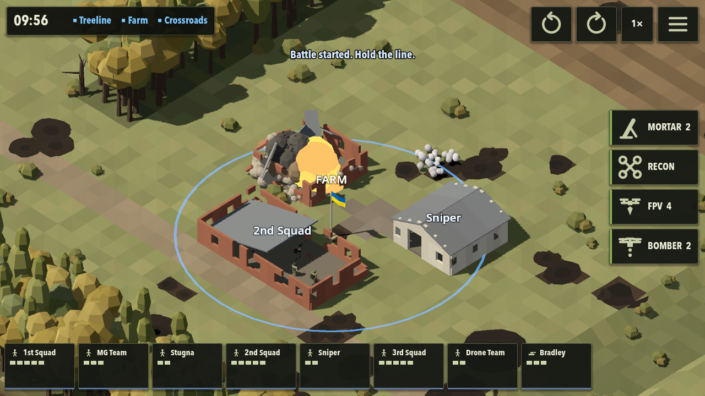
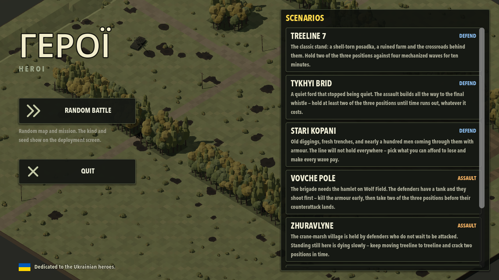
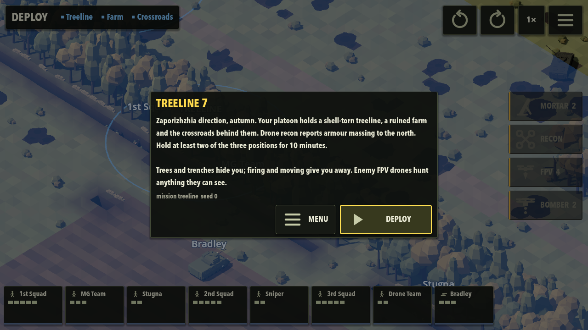

# Heroi (ГЕРОЇ)

Mobile isometric real-time tactics set in the Russo-Ukrainian war. You command a reinforced
Ukrainian platoon in short, tense battles where drones watch everything, fire suppresses before
it kills, and trees, trenches and ruins mean survival. Godot 4.7, GDScript, procedural meshes,
no textures.

**Dedicated to the Ukrainian heroes — the people defending their country. Слава Україні.**



| Start menu | Deployment |
| --- | --- |
|  |  |

## Honesty about authorship

Nothing in this repository is mine except the ideas and a passion for strategy games.
The code, the procedural art, the game design document and this README were written by
[Claude](https://claude.com/claude-code) (Anthropic's Claude Code) under my direction.
The audio is CC0 recordings by their original authors, credited in
[assets/audio/SOURCES.md](assets/audio/SOURCES.md). Treat the code accordingly: it is a
vibe-coded experiment, not an example of hand-crafted engineering.

- Design: [docs/GDD.md](docs/GDD.md)
- Play on desktop: `godot --path .` (mouse = touch, wheel zoom, WASD pan, Q/E rotate, Esc options)
- Open in the editor: `godot -e --path .`
- Headless full-battle test: `godot --headless --path . --fixed-fps 30 --quit-after 6000 -- autostart fast log`

## Install on Android

**Download the APK from the [latest release](https://github.com/aleszorc/heroi/releases/latest)**, open it on the phone, and allow installs from unknown sources when prompted.

Or build the debug APK yourself (one command):

```sh
godot --headless --path . --export-debug "Android" build/heroi.apk
```

Then install it on the phone, either way:

- **USB (adb):** enable USB debugging on the phone, connect it, run `adb install build/heroi.apk`.
- **No cable:** AirDrop/copy `build/heroi.apk` to the phone and open it there (allow installs from unknown sources when prompted).

Notes: the APK is a debug build signed with the standard debug keystore (`~/.android/debug.keystore`), arm64 only. iOS is not covered — it needs Xcode and an Apple developer account.

## License

[MIT](LICENSE). Audio files are CC0 / public domain (see [assets/audio/SOURCES.md](assets/audio/SOURCES.md)).
